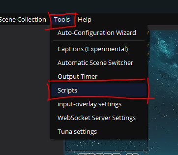
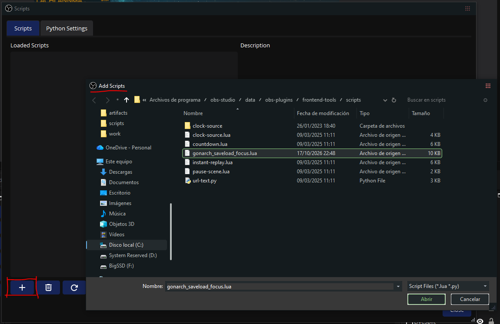
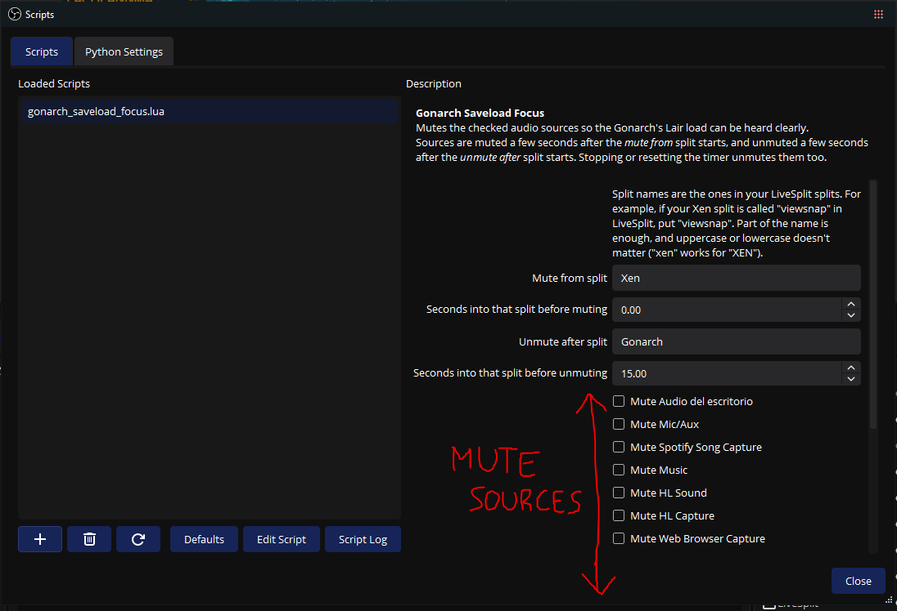

# Gonarch Saveload Focus

Download from [here](https://github.com/fireblizzard/obs-gonarch-saveload-focus/releases/latest/download/gonarch_saveload_focus.lua) (latest release, right side of this page if you're on the PC).

This is a small OBS script for Half-Life speedrunners that should allow you to focus properly on the sound cues for the [Gonarch saveload strat](https://www.youtube.com/watch?v=MO6DBXMfgX4&list=PLMBRVm_PJgpCK3iIsugoho-YFhvquzAxT&index=17). It mutes whatever you pick in OBS (music, alerts, chat sounds...) around that moment and unmutes it again afterwards. So if you're afraid of a follow alert or a Discord sound popping up and ruining your run, you can use this to mute those audio sources.

## Requirements

OBS Studio 28 or newer and LiveSplit open while you speedrun.

## Setup

1. Download `gonarch_saveload_focus.lua` and put it in a folder where it won't be deleted accidentally, since OBS loads it from there every time it starts.

2. In OBS, go to **Tools → Scripts**.

   

3. Click **+** and pick `gonarch_saveload_focus.lua`.

   

4. Click the script in the list and its settings show up on the right:
   - **Mute from split** is the name of your Xen split in LiveSplit.
   - **Unmute after split** is the name of your Gonarch's Lair split.
   - The two **Seconds into that split...** fields are how long it waits before muting and before unmuting. The defaults should be fine.
   - Tick **Mute ...** for every source you want silenced. Leave the game's own sound unticked, otherwise viewers won't hear it either.

   

5. Close the window. The script keeps running, also after restarting OBS.

## Split names

Use the names from your own splits from LiveSplit. If your Xen split is called "viewsnap", put `viewsnap`. Part of the name is enough (`Gonarch` works for "Gonarch's Lair") and uppercase or lowercase doesn't matter.

## How it works

The script checks which split you're on in LiveSplit. When your Xen split starts, it mutes the sources you picked, and 15 seconds into your Gonarch's Lair split it unmutes them. Resetting the timer or closing LiveSplit also unmutes them. All of this is customizable.

It only unmutes what it muted itself, so anything you had muted by hand stays muted.

## Checking that it works

Open LiveSplit, start the timer and split until you reach Xen. You can just make new splits quickly with just Lambda Core, Xen and Gonarch, load before Xen (e55 save) and test with that. Then get to Xen and see your picked sources muted in OBS.

If you click **Script Log** in the Scripts window you should see `Muted` with the names of your sources.
